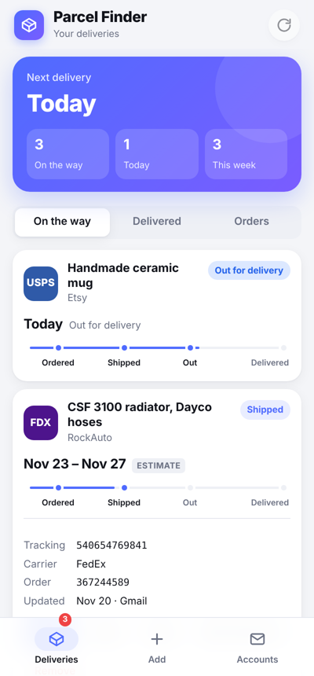
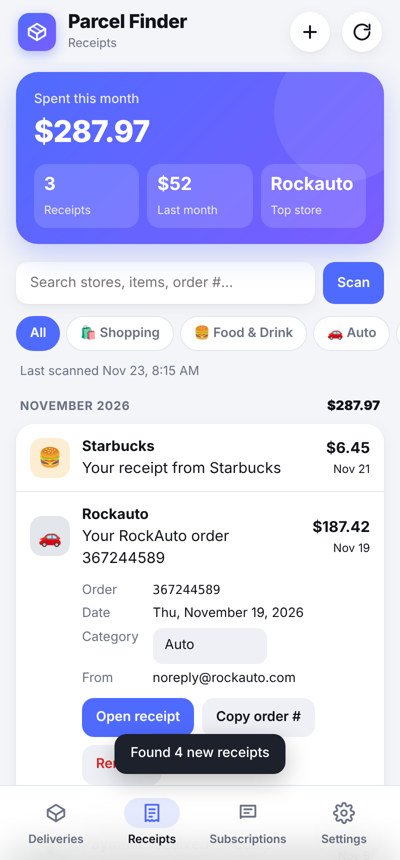
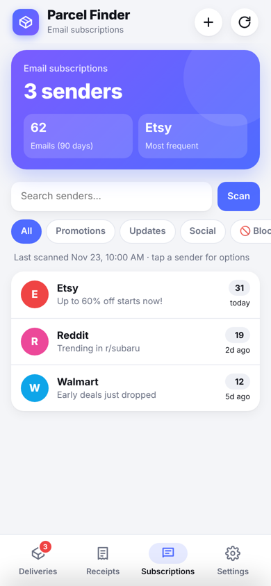
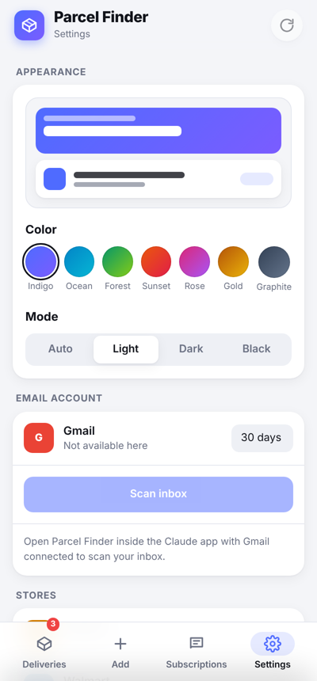

# 📦 Parcel Finder

**Track every package, receipt and email subscription — straight from your inbox.**

Parcel Finder reads your shipping, order and receipt emails from Gmail and turns them into a clean phone app: where each package is and when it arrives, what you've spent this month, and which senders flood your inbox — with one-tap unsubscribe.

  
  
  
  

## Features

**📦 Deliveries**
- Finds tracking numbers for UPS, USPS, FedEx, DHL, Amazon, OnTrac and more
- Status timeline (Ordered → Shipped → Out for delivery → Delivered) and arrival dates
- Delivery estimates when the email doesn't give a date
- Amazon and Walmart orders tracked even without a tracking number
- One tap to the carrier's live tracking page

**🧾 Receipts**
- Collects receipts, order confirmations and payment confirmations
- Monthly spending totals, top store, categories and search
- Copy everything as a spreadsheet for Google Sheets or Excel

**✉️ Subscriptions**
- Lists every newsletter and mailing list, sorted by how often they email you
- Unsubscribe in the app: block the sender, clear their old emails, or send an unsubscribe request
- Blocked senders are cleaned out automatically on every refresh

**🎨 And more**
- Multiple Gmail accounts
- 7 color themes with Light, Dark and Black (OLED) modes
- Works offline with your saved data; backup & restore
- Your data stays on your phone and in your own mailbox — no server

## Install

| Way | How |
|---|---|
| **Obtainium (recommended)** | Open Obtainium → **Add App** → paste `https://github.com/amon3411/parcel-finder` → **Add** → **Install**. Updates appear automatically. |
| **APK** | Download the latest `parcel-finder-x.y.z.apk` from [Releases](https://github.com/amon3411/parcel-finder/releases/latest) and open it on your phone. |
| **Web app** | Open [amon3411.github.io/parcel-finder](https://amon3411.github.io/parcel-finder/) in Chrome → **⋮** → **Install app**. |

Then open **Settings → Email accounts** and sign in. Google will warn that the app isn't verified — that's expected for a personal app; tap **Continue**.

## How it works

- `src/` — the app source: `shell.html` (screens), `logic.js` (tracking/receipt detection), `gmail.js` (scanning)
- `mail-shim.js` — connects to Gmail (Google sign-in + Gmail API), with multiple accounts and automatic reconnect
- `config.js` — sign-in client IDs (not secrets; they only work from this site's address)
- `python3 src/build.py` — builds `index.html` (web/phone app) and `claude/index.html` (Claude version)
- `android/` — Android app (Trusted Web Activity) that opens the web app full-screen
- `.github/workflows/android.yml` — builds a signed APK and publishes a GitHub Release for each new version

## Releasing an update

1. Edit `src/`, bump `APP_VERSION` and add a `CHANGELOG` entry in `src/shell.html`.
2. `python3 src/build.py`, commit and push.
3. GitHub builds the APK and publishes release `v<version>` with notes from the changelog; Obtainium picks it up.

The signing key lives on a private draft release named `signing-key`, encrypted with the `KEYSTORE_PASSWORD` secret — don't delete or publish it.
